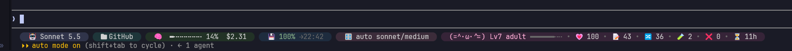

# statusline-pills



A rounded, muted-pill status line for Claude Code: model, folder and branch, context bar and cost, prompt-cache hit rate, subagent tuner mode, and the pet skill's stats. Run `/pills` to copy the bundled script to `~/.claude/statusline.ps1` (the previous copy is kept as `.bak-pills`); it then prints the `statusLine` entry that `settings.json` needs. Requires PowerShell 7 (`pwsh`) and a Nerd Font in your terminal for the rounded caps and folder and branch icons.

## Install

At the prompt of a terminal session:

```
/plugin install statusline-pills --marketplace kheirou/statusline-pills
```

From a shell:

```
claude plugin install statusline-pills --marketplace kheirou/statusline-pills
```

Then run `/pills` once to install the script, and point `statusLine` in `~/.claude/settings.json` at it (the command prints the exact entry).
